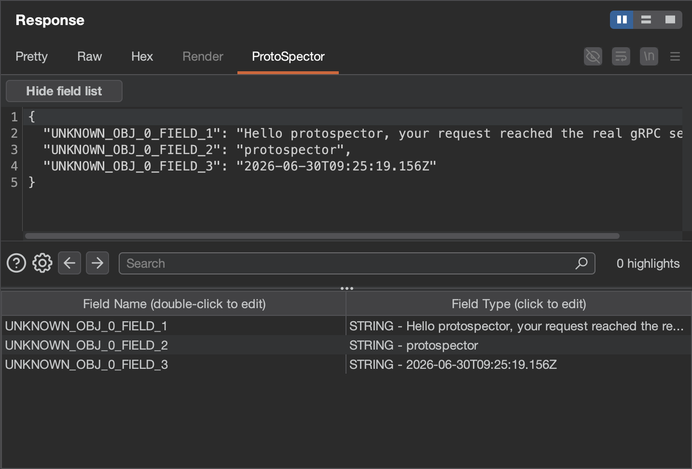
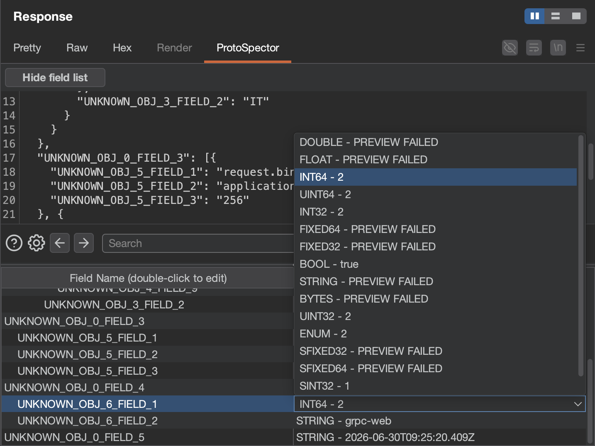
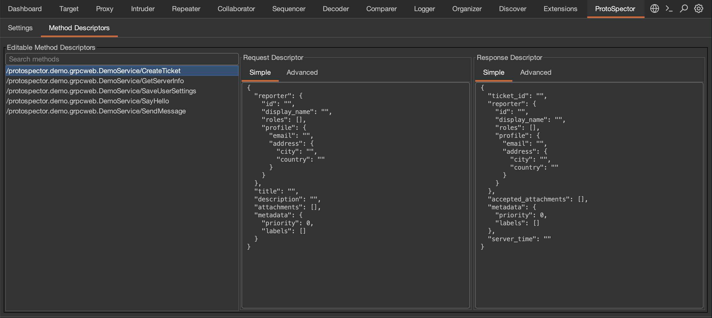

# ProtoSpector - Burp Extension for Working with Protocol Buffers (protobuf) and gRPC services.
## 🚀 Introduction

ProtoSpector simplifies Protobuf security testing in Burp Suite. The extension allows you to effortlessly decode and encode Protobuf messages using either a whitebox approach (with proto schemas) or a blackbox approach (directly working on raw Protobuf data).

## ⭐ Features

### 🔄 Intelligent Message Decoding & Encoding

The extension automatically detects Protobuf content types and adds a **ProtoSpector** tab to the request view.

**As of now only `application/grpc-web+proto` and `application/grpc-web-text` content types are supported, more are underway!**

It supports two testing approaches:

* **Whitebox Testing:** Automatically matches and decodes messages using pre-loaded `.proto` schemas (`.pb` descriptor files compiled via `protoc`).

* **Blackbox Testing:** If no schema is found, it automatically infers the underlying structure, allowing you to view and fully edit the decoded message for outgoing requests (e.g., inside the Repeater tool). 

### 🛠️ Dynamic Signature Editing

For blackbox testing scenarios, the **ProtoSpector** tab includes an interactive fields table that displays inferred Message Descriptors.



* **Inline Editing:** Easily update field names or data types on the fly by clicking directly into the table cells.
* **Type Previewing:** Instantly preview how any field renders when interpreted as a different data type using the built-in selector. If a preview fails, it is typically due to an incompatibility, such as having insufficient bytes to parse the data into a larger type.
* **Toggleable Interface:** The signature editing table can be hidden or shown at any time via the Settings tab.

### 🗺️ Advanced Schema & Method Management

* **Global Extension Tab:** Deeply inspect, manage, and customize the signature of every loaded Method Descriptor across your entire session.

* **gRPC Automation:** Once a `.pb` file is loaded, you can select any gRPC method from the central list, right-click, and seamlessly **Send to Repeater** to automatically structure your request.
* **Auto-Generation:** Clicking the **ProtoSpector** tab on an unknown request automatically generates and populates the global **Method Descriptors** tab with a brand-new descriptor.

## 📋 Prerequisites

* **Burp Suite**: Professional or Community Edition (2025.2 or later recommended)
* **protoc**: Protocol Buffer compiler (for generating `.pb` descriptor files)
* **Java Development Kit (JDK)**: Java 17 or later (for building)

## 📦 Installation

1. Download the extension deliverable from the "GitHub Releases" page
2. Open Burp Suite
3. Go to **Extensions** → **Installed** → **Add**
4. Select **Extension type**: Java
5. Click **Select file** and choose the downloaded `.jar` file
6. Click **Next** and verify the extension loads without errors

ℹ️ We've also submitted the extension to the [Portswigger's BApp Store](https://portswigger.net/bappstore). Currently waiting on their approval process.

## ⚙️ Compiling .pb Files

To create a descriptor set from your `.proto` files:

```sh
protoc --include_source_info --include_imports --descriptor_set_out=descriptor.pb $(find . -name '*.proto')

```

This command:

* Includes source info (for better error messages)
* Includes imported proto files
* Outputs a single descriptor set file (`descriptor.pb`)
* Finds all `.proto` files in the current directory and subdirectories

## 🏗️ Building the Extension

The extension uses the Shadow plugin to bundle all dependencies (including protobuf) and relocate them to avoid conflicts with Burp's bundled protobuf version.

### Build Command

```sh
./gradlew clean shadowJar

```

The built JAR will be located at: `app/build/libs/app.jar`

### Build Details

* **Java Compilation Target**: Java 17 (for Shadow plugin compatibility)
* **Runtime Compatibility**: Java 17+ (runs on Java 21)
* **Protobuf Version**: 3.25.3 (bundled and relocated to avoid conflicts)

## 🔍 Technical Details

### Dependency Management

* **Protobuf**: Version 3.25.3 (bundled and relocated to `doyensec.protospector.shaded.com.google.protobuf`)
* **Shadow Plugin**: Version 9.4.2 (for dependency bundling and relocation)
* **Burp Montoya API**: Version 2025.2 (compile-only dependency)

## 🤝 Contributing

The ProtoSpector Burp Extension thrives on community contributions. Whether you're a developer, researcher, designer, or bug hunter, your expertise is invaluable to us. We welcome bug reports, feedback, and pull requests. Your participation helps us continue to improve the extension, making it a stronger tool for the community.

Communication is best handled through the GitHub issue tracker, but you can also reach us on social media (@Doyensec). We look forward to hearing from you!

## 👥 Contributors

**Authors:** 
* [Luca Molteni](http://github.com/lucamolteni-doyensec)
* [Karim Rahal](http://github.com/karim-ds)


This project was made with the support of [Doyensec](https://doyensec.com/research.html).


